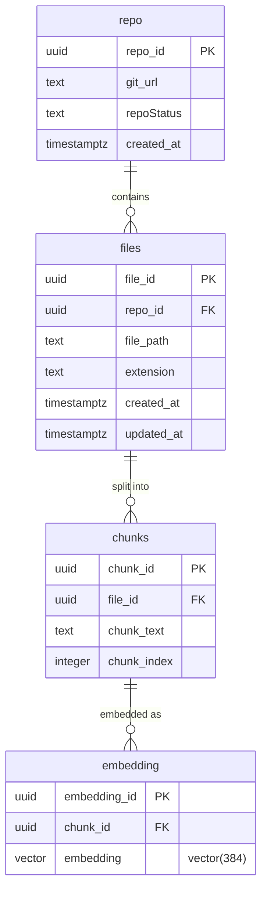
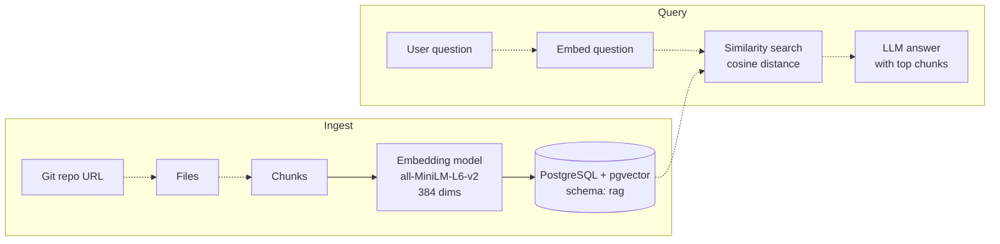

# rag-assistant

A learning project for a RAG (Retrieval-Augmented Generation) assistant over code repositories.

Stack: Spring Boot 4.1.2, Java 17, Maven, Spring Data JPA, PostgreSQL + pgvector, Liquibase. A Python script is used for embedding tests.

## Status

| Part | State |
|---|---|
| PostgreSQL config | Done (`application.yaml`, values from `.env`) |
| Schema `rag` + 4 tables | Done (Liquibase changelog `001`) |
| Embedding smoke test | Done (`scripts/embed_test.py`) |
| Repo ingestion, chunking, search, LLM answer | Planned |

## Database schema

All app tables live in the `rag` schema. Liquibase tracking tables stay in `public`.



## RAG flow

Solid boxes exist today. Dashed boxes are planned.



## Local setup

1. Install PostgreSQL and the `pgvector` extension.
2. Create the database:
   ```
   createdb rag_assistant
   ```
3. Create a `.env` file in the project root (it is git-ignored):
   ```
   DB_USERNAME=<your postgres user>
   DB_PASSWORD=<your password, or empty>
   ```
4. Run the app. Liquibase creates the `rag` schema and tables on startup:
   ```
   ./mvnw spring-boot:run
   ```

## Embedding smoke test

Inserts one test repo, one file, two chunks and their embeddings. Each run adds new rows.

```
pip install sentence-transformers psycopg2-binary
python scripts/embed_test.py
```

Note: the script uses a hardcoded local connection (`localhost`, `rag_assistant`). Edit it for your setup.
